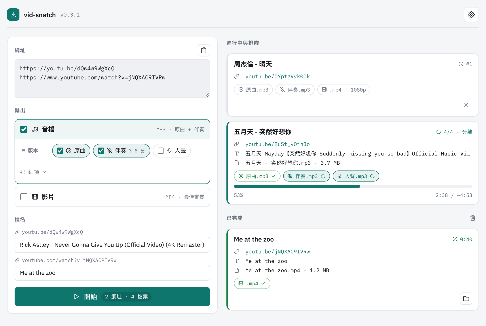

# vid-snatch

貼上 YouTube 網址，下載成 MP3 或 MP4，也可以去除人聲。在瀏覽器裡操作，不用打指令。



## 安裝

1. 安裝 [Docker Desktop](https://www.docker.com/products/docker-desktop/)。這是唯一需要先裝的東西。第一次開啟時，它可能會要你同意條款，按 Accept 即可。
2. 到[本專案的 GitHub 頁面](https://github.com/irene-chou/vid-snatch)，按 `Code` → `Download ZIP`，下載後解壓縮。
3. 雙擊資料夾裡的啟動檔。
   - macOS：`vid-snatch.command`
   - Windows：`vid-snatch.bat`

第一次執行時，系統可能會擋一下：

- **macOS**：在 Finder 裡對 `vid-snatch.command` 按右鍵，選「打開」，再按一次「打開」。之後直接雙擊就行。
  - 如果沒有「打開」可以按（macOS 15 以後），請到「系統設定」→「隱私權與安全性」，往下找到 vid-snatch.command 的提示，按「仍要打開」。
- **Windows**：出現 SmartScreen 藍色視窗時，按「其他資訊」，再按「仍要執行」。

第一次啟動要下載或建置環境，約 3-5 分鐘，請耐心等候。

## 使用

1. 雙擊啟動檔。會跳出一個終端機視窗，瀏覽器也會自動打開 vid-snatch。
2. 貼上 YouTube 網址，可以按「貼上」，一行放一個網址。
3. 選格式：「音檔 MP3」、「去人聲 MP3」或「影片 MP4」。
4. 需要的話改檔名，按「開始」。
5. 完成後，按「顯示檔案」就能找到下載好的檔案。

終端機視窗要一直開著。關掉它，vid-snatch 就會結束。Windows 上，背景服務會在關閉視窗後約 15 秒自動停止。也可以在網頁的「⚙ 設定」裡按「結束 vid-snatch」。

## 常見問題

**Docker 跳出同意條款？**
按 Accept。按完後啟動會自動繼續。

**第一次為什麼很慢？**
第一次要下載或建置環境，約 3-5 分鐘，之後就快了。

**去人聲要多久？**
一首歌約 1–3 分鐘。

**檔案存在哪裡？**
預設在 `~/Music/vid-snatch`。Windows 是 `音樂\vid-snatch`。

**怎麼改儲存位置？**
按「⚙ 設定」→「更換資料夾」。下次啟動才會生效。

**怎麼更新？**
每次啟動都會自動檢查更新。想立刻更新，按「⚙ 設定」→「進階」→「更新 vid-snatch」。

**怎麼移除？**
按「⚙ 設定」→「進階」→「解除安裝」，再選要不要一併刪除下載檔案。選刪除時，也只有預設資料夾會被刪。改過儲存位置的話，請自己刪除。

**不小心關掉瀏覽器分頁？**
回到終端機視窗按 Enter，瀏覽器會重新打開。

**下載失敗，顯示「YouTube 改版」？**
vid-snatch 會自動更新下載工具再試一次，不用處理。

## 進階（工程師）

### Docker 指令列

```bash
# 建置映像檔（只需一次）
docker build -t vid-snatch .

# 下載音檔（MP3）
docker run --rm -it -v ~/Music/vid-snatch:/app/output vid-snatch "URL"

# 下載音檔並去除人聲
docker run --rm -it -v ~/Music/vid-snatch:/app/output vid-snatch "URL" --no-vocals

# 下載影片（MP4）
docker run --rm -it -v ~/Music/vid-snatch:/app/output vid-snatch "URL" --video
```

| 參數 | 說明 |
|------|------|
| `-o, --output` | 輸出資料夾（預設 `./output`） |
| `--video` | 下載影片（MP4），不是音檔 |
| `--no-vocals` | 用 Demucs 去除人聲 |
| `--web` | 啟動網頁介面（啟動腳本使用） |

Demucs 模型已內建在映像檔裡。設定檔在 `~/.config/vid-snatch/config`。

### 本機開發

需要 Python 3.10 以上。

```bash
uv venv --python 3.12 .venv
uv pip install --python .venv/bin/python -e ".[dev]"
.venv/bin/pytest -q
```

### 預建映像檔

推送到 `main` 時，GitHub Actions 會發佈 amd64 與 arm64 映像檔：

```bash
docker pull ghcr.io/irene-chou/vid-snatch:latest
```
